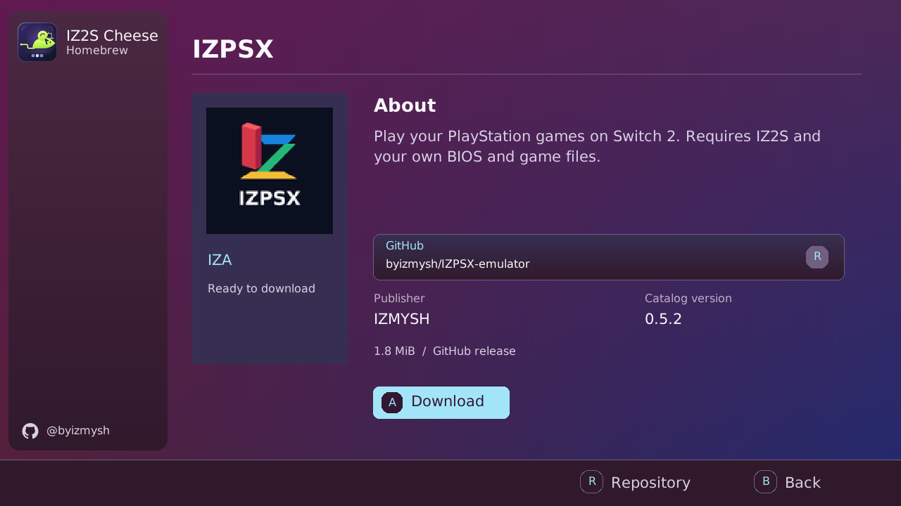

# IZ2S Store

A homebrew store for Nintendo Switch 2.

  
  

## Choose your build

| Console environment | Supported apps |
| --- | --- |
| [IZ2S](https://github.com/byizmysh/IZ2S-Platform) | **.iza** and **.nro** |
| [kaiHEN](https://github.com/ouncebrew/kaihen) | **.nro** |

## Install on IZ2S

The Store runs from its own module. Install the complete SD bundle so the executable and its engine are installed together. At startup, the Store checks that the launcher provides the functions it needs. Use an updated IZ2S Platform runtime and restart the IZ2S session after updating it.

- **From microSD.** Extract [`iz2s-store-iza-sd.zip`](https://github.com/byizmysh/iz2s-store/releases/latest/download/iz2s-store-iza-sd.zip) on your PC. Copy the extracted `iz2s/` folder to the root of the card. Keep `launcher.iza`, `sd-bundle.json` and its `asset-*.izdata` file together in `/iz2s/modules/iz2s-store/`. The executable alone is not a complete installation. Open the **IZ2S Store** tile.
- **From IZ2S Platform on PC.** Connect the console via PC Link, open **App library → Add app**, and select `iz2s-store-iza-sd.zip` directly. The panel imports the ZIP. If the import is still queued, open **Add App** on the console.

The Store installs apps to `/iz2s/modules/<id>/launcher.iza` or `/iz2s/modules/<id>/launcher.nro`.

### Install on kaiHEN

Extract [`iz2s-store-nro-sd.zip`](https://github.com/byizmysh/iz2s-store/releases/latest/download/iz2s-store-nro-sd.zip) to the card root or copy `iz2s-store.nro` to `/switch/iz2s-store/iz2s-store.nro`. Launch **IZ2S Store** from the homebrew menu. The Store installs apps to `/switch/<id>/<id>.nro`. IZA apps require IZ2S Platform.

## Add a catalog

Catalogs have **no fixed app-count limit**. Thumbnail images load on demand into a small cache. Install the current Store build before loading a catalog that exceeds an older build's limit.

The list is empty on first launch. Press **−**, select **Catalog URL**, and paste the raw URL of `catalog.tsv`.

The Store looks for `artwork.bin` alongside `catalog.tsv`. It saves the list and thumbnails to the card for offline browsing. Use **Settings → Download catalog** to refresh both files. IZ2S can download IZA and NRO apps from the same catalog. On kaiHEN, IZA entries are marked as requiring IZ2S.

For a local catalog, place `catalog.tsv` and `artwork.bin` in `/iz2s/modules/iz2s-store/catalog/` for IZA or `/switch/iz2s-store/catalog/` for NRO. Select **Settings → Catalog source → SD card**, then **Reload SD catalog**.

## Publish your own catalog

Create a separate public GitHub repository. Put `catalog.tsv` and `artwork.bin` at the root of the `main` branch. Open `catalog.tsv`, click **Raw**, and copy the URL into IZ2S Store.

See the [catalog format](docs/catalog-format.md) to list IZA releases and their companion files.

## Update the Store

Open **Settings → Store update**. The selected catalog must contain the official IZ2S Store release for your edition: IZA on IZ2S, NRO on kaiHEN. The Store verifies the downloaded files, keeps the previous executable and asks you to reopen the app. Rebuilt releases with the same version are detected by SHA-256.

Both editions contain their own application code. IZA uses SDK services for networking, TLS, the system keyboard and threads. Catalogs and artwork are published separately.

See [building and native modules](docs/building.md) for SDK requirements and checks.
